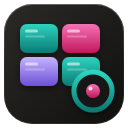

<p align="center">
  
</p>

<h1 align="center">Desk-Remote</h1>

<p align="center">
  <b>Kendi bilgisayarlarınızı, kendi özel ağınız üzerinden görün ve yönetin.</b><br>
  Windows için uzak masaüstü: ekran, klavye, fare ve dosya gönderme. Bulut hesabı yok, üçüncü taraf uzak masaüstü servisi yok.
</p>

<p align="center">
  <a href="https://github.com/RbnApp/desk-remote/releases/latest"></a>
  <a href="#-gereksinimler"></a>
  <a href="LICENSE"></a>
  <a href="https://github.com/RbnApp/desk-remote/issues/new"></a>
  <a href="https://tauri.app/"></a>
</p>

---

## 🧭 Nedir?

Desk-Remote iki küçük programdan oluşur. **Ajan**, ulaşmak istediğiniz her bilgisayara kurulur ve Windows ile
birlikte açılır. **Panel**, bağlandığınız bilgisayara kurulur: bilgisayarlarınızı kartlar halinde listeler, birine
tıklayınca ekranını gösterir ve fareyle klavyeyi o bilgisayara iletir.

Aradaki bağlantı [Tailscale](https://tailscale.com) özel ağınızdan geçer. Uygulamanın içinde gömülü bir Tailscale
yardımcısı vardır; ağa kullanıcı alanında katılır, bilgisayarınıza sürücü kurulmaz.

## ✨ Özellikler

### 🖥️ Uzak ekran, klavye ve fare
- Bağlandığınız bilgisayarın ekranı paneldeki sekmede canlı görünür; her bilgisayar kendi sekmesinde açılır,
  birkaç bilgisayara aynı anda bağlanabilirsiniz.
- Üst çubukta gecikme, saniyedeki kare sayısı ve çözücünün donanım mı yazılım mı olduğu görünür.
- **Kontrol açık** düğmesiyle fare ve klavye uzak bilgisayara geçer; kapatınca yalnız izlersiniz.
- Tam ekran desteği vardır; uzak imleç ayrı bir katman olarak çizilir.
- **UAC penceresi ve kilit ekranı da görünür ve tıklanabilir.** Ayrı bir ayar yoktur; bağlantı bu ekranlarda kopmaz.

### 📁 Dosya gönderme
- Windows 11 Gezgini'nde bir dosyaya sağ tıklayıp **Desk-Remote ile gönder** diyerek eşleşmiş bir bilgisayara
  dosya yollarsınız. Gelen dosya alıcı bilgisayarın İndirilenler klasöründeki `Desk-Remote` klasörüne düşer.
- Alıcı bilgisayarda her gelen dosya için bildirim çıkar.

### 🔒 Güvenlik
- Bilgisayarlar bir kez **tek kullanımlık kodla** eşleşir; eşleşmiş panel sonra kodsuz bağlanır.
- Ajan yalnız özel ağlardan gelen bağlantıları kabul eder (yerel ağ, Tailscale, loopback).
- Her bağlantı ve her gelen dosya günlüğe yazılır; panel ilk bağlandığında bilgisayarda bildirim çıkar.
- Eşleşmeyi iki taraftan da kaldırabilirsiniz: panelde bilgisayar kartındaki kaldır düğmesi, bilgisayarın tepsi menüsünde
  **Eşleşmiş paneller**.
- Tepsi menüsündeki **Uzaktan kontrolü engelle (yalnız izleme)** ve **Tüm izleyicileri şimdi ayır** ile
  bilgisayarın sahibi istediği an kontrolü alır.
- Ayrıntı: [güvenlik modeli](docs/architecture/remote-agent-security-model.md).

### 🔄 Güncelleme
- Panel ve ajan en son GitHub sürümünü denetler, SHA-256'sını doğrular ve kendini günceller.
- **Ayarlar → Güncellemeler** sekmesinde elle denetim ve "açılışta güncelle" anahtarı vardır; ajanın tepsi
  menüsünde **Güncellemeleri denetle** bulunur.

### 🎨 Arayüz
- Türkçe ve English arayüz. Mürekkep ve petrol temaları; sistem, açık ve koyu kip.

## 🎛️ Kullanım

| Ne | Nasıl |
|---|---|
| **Bilgisayar ekleme** | Panelde **PC ekle**'ye basın, bilgisayarın Tailscale adresini ve ajanın gösterdiği tek kullanımlık kodu girin. Kod, ajanın tepsi menüsündeki **Eşleştirme kodunu göster** ile açılır. |
| **Bağlanma** | Bilgisayar kartındaki **Bağlan**'a basın. Kartlar **Tümü**, **Çevrimiçi**, **Çevrimdışı**, **Bağlanıyor** ve **Uyarı** süzgeçleriyle listelenir. |
| **Yeniden adlandırma ve kaldırma** | Kartta kalem simgesi adı panelde değiştirir (yeni ad yalnız o panelde görünür), çarpı eşleşmeyi kaldırır. |
| **Ajan tepsi menüsü** | Çevrimiçi izleyici sayısı, bilgisayar adı, yerel IP ve Tailscale adresi (tıklayınca kopyalanır), eşleştirme kodu, bağlı izleyiciler, eşleşmiş paneller, **Ayarlar…** ve **Hakkında…** burada. |
| **Ajan ayarları** | Tepsi menüsünden **Ayarlar…**: cihaz adı, dil, oturum açılışında başlatma, hizmetle başlatma, otomatik güncelleme, gözetimsiz erişim, yalnız izleme, yükleme sınırı ve eşleşmiş paneller. |
| **Bağlantı sekmesi** | Panelde çevrimiçi cihaz sayısı ile tailnet'teki toplam cihaz sayısı ayrı gösterilir. |

## 🚀 Kurulum

[Son sürüm](https://github.com/RbnApp/desk-remote/releases/latest) sayfasından iki kurulum dosyasını indirin:

| Kurulum dosyası | Nereye kurulur |
|---|---|
| `DeskRemote-Agent-Setup-<sürüm>.exe` | Ulaşmak istediğiniz **her bilgisayara** (Windows hizmeti ve oturum yardımcısı). |
| `DeskRemote-Panel-Setup-<sürüm>.exe` | Bağlandığınız bilgisayara (panel). |

1. Ajanı uzaktan erişmek istediğiniz bilgisayara, paneli kendi bilgisayarınıza kurun.
2. İki bilgisayarın da aynı Tailscale ağına girmiş olması gerekir.
3. Ajanın tepsi menüsünden eşleştirme kodunu alın, panelde **PC ekle** ile girin.
4. Dosyaları aynı sürümün `SHA256SUMS.txt` dosyasıyla karşılaştırabilirsiniz.

Kurulum dosyaları **imzasızdır**; Windows SmartScreen uyarı verir: **Daha fazla bilgi → Yine de çalıştır**.
Bu beklenen durumdur.

## 📋 Gereksinimler

| Gereksinim | Neden |
|---|---|
| Windows 10 veya Windows 11, x64 | Kurulum paketleri x64 olarak üretilir. |
| Tailscale hesabı | Bilgisayarlar birbirine Tailscale özel ağı üzerinden bağlanır. |
| Ajan kurulumunda yönetici izni | Ajan bir Windows hizmeti olarak kurulur. |

Çalıştırmak için başka bir sunucu, bulut hesabı ya da uzak masaüstü servisi gerekmez; yalnız kaynaktan
derlemek için **Rust**, **Go** ve **Tauri CLI** gerekir (aşağıdaki bölüm).

## 💬 Geri bildirim

Hata ve istekleri [RbnApp/desk-remote · Issues](https://github.com/RbnApp/desk-remote/issues/new) sayfasından
yazabilirsiniz. Lütfen sürüm numarasını ve Windows sürümünü ekleyin; kimlik, şifre ve dosya yolu paylaşmayın.

## 🔢 Sürüm

Biçim **ANA.ARA.YAMA**'dır (şu an: `0.1.2`). Tek kaynak kökteki `VERSION` dosyasıdır. Sürüm yalnız yeni bir yapı
yayımlanırken yükseltilir: `main`'e `VERSION`'ı değişen bir commit gelince GitHub Actions iki kurulum dosyasını
derler, `v<sürüm>` etiketini ve Release'i açar. Sürüm notları [CHANGELOG.md](CHANGELOG.md) içinde tutulur;
akış [release.md](docs/architecture/release.md) içinde anlatılır.

## 📄 Lisans

MIT — ayrıntılar için [LICENSE](LICENSE). Telif: © 2026 rbnbilisim.

## 🛠️ Geliştirme

Gerekenler: Rust (stable), Go (`apps/desk-tailnet-helper` için), Tauri CLI v2, Windows 10/11 x64.

```powershell
./scripts/build-installers.ps1   # iki kurulum dosyasını ve SHA256SUMS.txt'yi dist\ içine yazar
```

| Yol | İçerik |
|---|---|
| `apps/desk-service/` | Ajan: Windows hizmeti (`DeskRemote-Agent.exe`), ekran yakalama ve kodlama hattını başlatır |
| `apps/desk-session/`, `apps/desk-session-helper/` | Oturum yardımcısı (`DeskRemote-Session.exe`): tepsi simgesi, yakalama, girdi enjeksiyonu |
| `apps/desk-panel/` | Panel: bilgisayar seçip bağlandığınız Tauri uygulaması |
| `apps/desk-tailnet-helper/` | Tailscale ağına kullanıcı alanında katılan gömülü Go yardımcısı |
| `apps/desk-shell-ext/` | Windows 11 Gezgini "Desk-Remote ile gönder" menüsü |
| `crates/` | Ortak mantık: protokol, şifreleme, aktarım, yapılandırma, güncelleme; her konunun tek sahibi var |
| `docs/architecture/` | [Klasör düzeni](docs/architecture/folder-layout.md), [merkezi sistemler](docs/architecture/central-systems.md), [güvenlik modeli](docs/architecture/remote-agent-security-model.md), [sürüm akışı](docs/architecture/release.md), [otomatik kapılar](docs/architecture/gates.md) |

---

<p align="center"><sub>© 2026 rbnbilisim · Desk-Remote · info@rbnbilisim.com.tr</sub></p>
